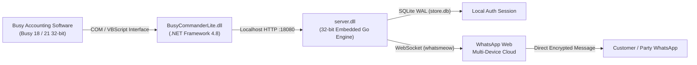

# BusyCommanderLite 🚀

[](https://github.com/busycommanderlite/BusyCommanderLite/releases/latest)
[](LICENSE)
[](https://www.microsoft.com/windows)
[](https://busy.in)
[](#license)

> **The 100% Free, Open-Source WhatsApp Automation & Smart Utility Suite for Busy Accounting Software.**  
> Send invoices, payment QR codes, outstanding hisab slips, and receipt notifications straight to WhatsApp directly from Busy — no recurring subscriptions, no cloud API fees, and no third-party gatekeepers.

---

## 📥 Instant Download

Get the official, pre-compiled Windows installer:

👉 **[Download BusyCommanderLite v1.0.0 Setup (ZIP)](https://github.com/busycommanderlite/BusyCommanderLite/releases/latest/download/BusyCommanderLite_Setup_v1.0.0.zip)**  
*(Extract the ZIP and run `setup.exe` to install in under a minute)*

---

## 📺 Video Tutorial & Live Demo

Watch the complete setup and live workflow in action:

[](https://www.youtube.com/watch?v=BBclg-Lzdig)

▶️ **[Watch the full tutorial on YouTube: How to Send WhatsApp Messages Directly from Busy Accounting Software](https://www.youtube.com/watch?v=BBclg-Lzdig)**

---

## ✨ Key Features

| Feature | Description |
| :--- | :--- |
| 📄 **Automated PDF & Image Invoicing** | Send sales invoices directly to party WhatsApp numbers with custom caption templates (Invoice #, Date, Amount, Pending Balance). |
| 💳 **Dynamic Payment UPI QR Codes** | Automatically embeds the exact voucher amount into your merchant UPI QR code and delivers it to the customer for instant 1-tap payment. |
| 📊 **Graphical Hisab / Ledger Slips** | Generates beautifully formatted, clean image slips of pending bills and payments with aging calculations (*"X दिन"*), total dues (*"कुल बाकी"*), and date details. |
| 🇮🇳 **KrutiDev 010 & Hindi Transliteration** | Seamlessly converts KrutiDev 010 Print Names into clean Unicode Hindi text for hisab slips and notifications. Includes interactive Google Transliteration fallback. |
| 🔔 **Payment Receipt (Jama) Alerts** | Sends instant confirmation WhatsApp messages to customers when receipt vouchers are entered, with optional auto-forwarding to internal staff/management groups. |
| 🚛 **Transport & Dispatch Tracking** | Built-in Gadi / Transport slip tracker with quick shortcuts to record and share transport dispatch notes. |
| ⚡ **In-Process 32-bit Engine** | Embedded 32-bit Go HTTP server powered by `whatsmeow` with SQLite WAL mode persistence. Zero heavy browser automation (no Selenium / Puppeteer). |

---

## 🏗️ Architecture



- **Zero Cloud Middleman:** Messages flow directly from your machine to WhatsApp Web servers via WhatsApp's official multi-device protocol.
- **Resilient & Thread-Safe:** Built with SQLite WAL mode, in-memory JID lookup caching, and automated 30s network timeouts.
- **Indian Number Normalization:** Automatically normalizes 10-digit Indian mobile numbers (`XXXXXXXXXX`) and 11-digit numbers with leading zero (`0XXXXXXXXXX`) to canonical `+91` format.

---

## ⌨️ Keyboard Shortcuts (Inside Busy)

Once installed, use these single-key shortcuts directly within Busy:

### Sales Register
| Key | Action |
| :---: | :--- |
| <kbd>B</kbd> | Send Invoice via **WhatsApp** (PDF or Image) |
| <kbd>Q</kbd> | Send Invoice + **Payment UPI QR Code** (Fixed or Configured amount) |
| <kbd>M</kbd> | Send Custom WhatsApp message to party |
| <kbd>Shift</kbd> + *Initials* | Instant jump to party's invoice in list |
| <kbd>S</kbd> | **Create Dispatch Slip** (Add party + carton count) |
| <kbd>P</kbd> | **Print Dispatch Slip** (A6) & update voucher Long Narration |
| <kbd>C</kbd> | Clear current dispatch slip |
| <kbd>G</kbd> | **Update Gadi No.** (Vehicle/transport slip entry dialog) |
| <kbd>U</kbd> | Select Un-updated invoices (missing vehicle info) |

### Bill-wise Statement & Ledger
| Key | Action |
| :---: | :--- |
| <kbd>H</kbd> | Send **Hisab** statement to customer via WhatsApp |
| <kbd>T</kbd> | Calculate & show total amount of selected entries |
| <kbd>P</kbd> | Print Hisab (A6 size; auto-scales for long lists) |
| <kbd>B</kbd> | Send selected bill via WhatsApp |
| <kbd>Q</kbd> | Send configured QR code |
| <kbd>M</kbd> | Send custom WhatsApp message |

> 📖 **Need more details?** Check out the comprehensive **[Complete User Manual & Setup Guide (USER_MANUAL.md)](USER_MANUAL.md)** for detailed workflows on Dispatch Slips, DP verification, and Hindi transliteration.

---

## 🚀 Quick Start & Installation

### Prerequisites
- **Operating System:** Windows 10, Windows 11, or Windows Server (32-bit or 64-bit)
- **Accounting Software:** [Busy Accounting Software](https://busy.in) (Busy 18 / Busy 21)
- **Runtime:** Microsoft .NET Framework 4.8 (pre-installed on most modern Windows systems)

### 4-Step Setup
1. **Download & Install:**
   - Download **[BusyCommanderLite_Setup_v1.0.0.zip](https://github.com/busycommanderlite/BusyCommanderLite/releases/latest/download/BusyCommanderLite_Setup_v1.0.0.zip)**.
   - Extract the ZIP archive and run `setup.exe` (follow the standard Windows installer wizard).
2. **Open Busy & Register:**
   - Launch Busy Accounting and open your Company.
   - You will see the **BusyCommanderLite** setup prompt. Confirm to activate.
3. **Link WhatsApp:**
   - A clean QR code dialog will appear on screen.
   - Open WhatsApp on your phone &rarr; **Linked Devices** &rarr; **Link a Device** &rarr; Scan the QR code.
4. **Configure WhatsApp / SMS in Busy:**
   - In Busy, press <kbd>Ctrl</kbd> + <kbd>F</kbd> &rarr; **WhatsApp / SMS Configuration**.
   - Create a format (e.g. `BCommander`) and set the API URL:
     - **PDF Document:** `http://localhost:54321/send?phoneNo=mobNum&messageText=message`
     - **Auto-cropped Image:** `http://localhost:54321/sendimage?phoneNo=mobNum&messageText=message`
   - Select **Service Provider Server** (if hidden, press <kbd>Ctrl</kbd> + <kbd>Alt</kbd> + <kbd>V</kbd> to make it visible).
   - Done! You can now send invoices and reports using Busy's standard SMS button.

---

## ⚙️ Configuration (User Console)

Press your configured shortcut or open the **User Console** to personalize your automation:
- **Default WhatsApp Numbers (DN1–DN4):** Configure default staff or branch numbers for receiving backup notifications.
- **Notification Group:** Select an internal WhatsApp group to automatically receive receipt / dispatch notifications.
- **Merchant QR Code Image:** Point to your merchant UPI QR code image once; the engine automatically extracts the UPI ID and injects bill amounts dynamically.
- **Message Templates:** Customize invoice captions, hisab header/footers, and payment thank-you text with merge tags (`<PARTY>`, `<AMOUNT>`, `<BILLNO>`, `<DATE>`).

---

## 🛠️ Building from Source

If you want to modify or compile BusyCommanderLite yourself:

### Requirements
- **Visual Studio 2022** (with *.NET desktop development* workload)
- **Go 1.20+** with 32-bit MinGW GCC compiler (e.g. `mingw32`)

### 1. Build the 32-bit Go Server (`server.dll`)
```powershell
cd BusyCommanderLite\server
powershell -ExecutionPolicy Bypass -File build_32.ps1
```

### 2. Build the VB.NET COM DLL
```powershell
MSBuild.exe BusyCommanderLite.sln /p:Configuration=Release /t:Rebuild
```

### 3. Build the MSI Installer
```powershell
& "devenv.com" BusyCommanderLite.sln /build Release /project "BusyCommanderLite Setup\BusyCommanderLite Setup.vdproj"
```

---

## 🤝 Contributing

Contributions, bug reports, and feature suggestions are warmly welcomed!
1. Fork the repository: [https://github.com/busycommanderlite/BusyCommanderLite](https://github.com/busycommanderlite/BusyCommanderLite)
2. Create a descriptive feature branch (`git checkout -b feature/awesome-addition`).
3. Commit your changes (`git commit -m 'Add awesome new capability'`).
4. Push to your branch (`git push origin feature/awesome-addition`).
5. Open a **Pull Request**.

---

## 📜 License

This project is open-source software licensed under the **[MIT License](LICENSE)**. You are free to use, modify, distribute, and integrate it into your business or accounting workflows without any fee or royalties.

---

## 🙏 Credits & Acknowledgments

- Built with ❤️ for the Indian SME, accountant, and trader community.
- WhatsApp multi-device client powered by the incredible [whatsmeow](https://github.com/tulir/whatsmeow) library.
- Designed & hardened in collaboration with **Antigravity (Google DeepMind)**.

---

<p align="center">
  <b>BusyCommanderLite</b> — Empowering Busy Accounting users with free, fast, and modern automation.
</p>

